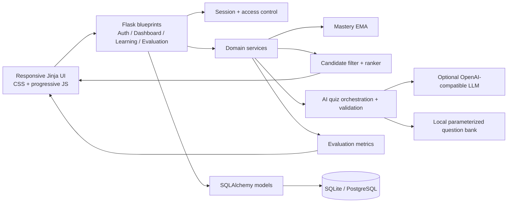
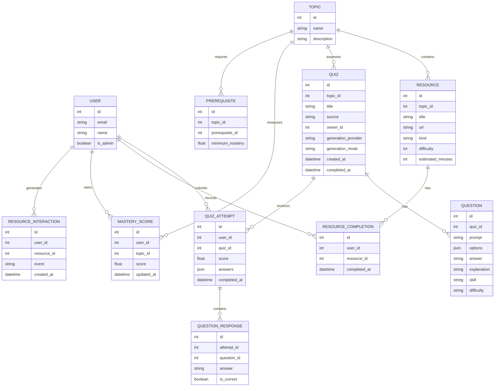

# Dynamic Learning

Dynamic Learning is a Flask learning-resource recommender. It combines fresh AI-generated practice quizzes, explicit resource completion, topic mastery, prerequisite-aware catalog metadata, and a transparent recommendation queue so a learner can always see a sensible next step.

This repository includes a complete Flask/SQLAlchemy application, a responsive learner interface, deterministic recommendation services, an optional live-AI quiz provider with a validated offline fallback, a seed catalog, and a pytest suite. The **AI Practice Studio** creates a new private set of 8–20 questions every time; the original short catalog quizzes remain available as classic quick checks.

For a guide-ready project explanation, demonstration script, objectives, base-paper mapping, algorithm summary, limitations, and viva discussion points, see [`PROJECT_GUIDE.md`](PROJECT_GUIDE.md).

## Setup

```bash
python -m venv .venv
# Windows
.venv\Scripts\activate
# macOS/Linux
source .venv/bin/activate
pip install -r requirements.txt
# Optional: use .env.example as a reference. This app reads process environment variables.
python seed.py
flask --app run.py run --debug
```

For PowerShell, set deployment values before launching, for example:

```powershell
$env:SECRET_KEY = "replace-with-a-long-random-value"
$env:APP_ENV = "production"
$env:ENABLE_DEMO_ACCOUNT = "0"
```

The application does not automatically load a `.env` file; use your process manager, shell, or a dotenv-aware deployment tool to export those values.

### Optional live AI provider

AI practice works out of the box with a local, validated question generator. To use a real LLM through any OpenAI-compatible Chat Completions endpoint, set:

```bash
export AI_API_KEY="your-provider-key"
export AI_API_BASE="https://api.openai.com/v1"   # optional
export AI_MODEL="gpt-4o-mini"                    # optional
export AI_TIMEOUT="25"                           # optional, seconds
export AI_QUIZ_DEFAULT_LENGTH="10"               # optional, 5–20
export AI_QUIZ_MAX_LENGTH="20"                   # optional, 8–20
```

The key is read only on the server and never sent to the browser. If the provider is unavailable or returns invalid questions, the app automatically falls back to the offline generator and tells the learner which mode was used. `OPENAI_API_KEY` is also accepted as a fallback variable name. No API key is included in this repository.

Open `http://127.0.0.1:5000/register`. The seed script creates the example catalog; it is safe to run against a fresh development database. Set a strong, random `SECRET_KEY` outside development. For tests:

```bash
python -m pytest -q
```

The seeded catalog still contains seven Python topics, 21 learning resources, seven short classic quizzes, and 25 curated questions. Those short quizzes are retained for the original reproducible audit. Longer, fresh practice comes from `/practice`, which creates a private `Quiz` row per session with 8–20 newly generated, server-validated questions and stores their explanations and skill tags. The default local development seed may create `demo@example.com` with password `password123` for a disposable walkthrough. This is a deliberately known administrator credential for a throwaway local database; it is not suitable for deployment. For deployment, set a long random `SECRET_KEY`, `APP_ENV=production`, and `ENABLE_DEMO_ACCOUNT=0`, then create separately managed accounts. The normal local `python seed.py` flow is otherwise unchanged.

To intentionally reset the local development database and reseed the catalog, run:

```bash
python seed.py --reset
```

**Destructive:** reset deletes every user, attempt, answer, mastery cache, interaction, and completion in the configured SQLite database and reseeds the catalog. Back it up first. Reset is now refused outside development/test or if any configured database/bind is non-SQLite. `APP_ENV=production` refuses reset entirely. `ENABLE_DEMO_ACCOUNT=0` allows a development reset without creating the demo account; it also blocks existing demo logins/sessions. Do not reset the project database just to run tests: the tests use disposable databases.

### Frontend route and context contract

The templates keep the existing endpoint names and work with the persisted SQLAlchemy models. The overview is deliberately data-led: it does not invent progress, scores, or recommendations when a learner has no activity yet. A topic is weak only after it has an attempt or an explicit stored assessment; an unassessed topic is displayed as **Not assessed**.

| Screen | Route / method | Required context |
| --- | --- | --- |
| Sign in | `auth.login` GET/POST | form fields `email`, `password` |
| Register | `auth.register` GET/POST | form fields `name`, `email`, `password` |
| Overview | `dashboard.dashboard` GET | `user`, `recommendations`, `topics`, `mastery`, `practice_topics`, `ai_provider` |
| AI Practice Studio | `learning.practice_studio` GET | `topics` with stored mastery/difficulty signals, `lengths`, `difficulties`, `provider`, `sessions` |
| Generate AI quiz | `learning.generate_practice` POST | form fields `topic_id`, `length`, `difficulty`; creates one private generated `Quiz` and redirects to its page |
| Library | `learning.library` GET | `resources`, `topics`; optional `query`, `selected_kind`, `selected_topic`, `completed_resource_ids` |
| Quiz | `learning.quiz_page` GET | `quiz` with `id`, `title`, `topic`, `questions`; each question has `id`, `prompt`, `options`, and optional `skill`/`difficulty`/`explanation` |
| Evaluation | `evaluation.evaluation_page` GET | `metrics` with observed fields plus `offline` benchmark report |

#### Overview context details

- `user` is the signed-in learner. The current templates read `user.name`, `user.attempts`, and `user.completions`; the existing relationships are sufficient, and `attempt_records` may be supplied as an explicit replacement for `user.attempts`.
- `topics` is the catalog ordered for display. Each topic should expose `id`, `name`, `description`, and its related `quizzes` (with quiz `id` and `title`). This powers topic-wise mastery and the four foundation links for Variables, Conditionals, Loops, and Functions.
- `mastery` is a mapping of assessed `topic_id` values to a score in `[0, 1]`. Topics absent from this mapping are shown as **Not assessed**, not as fabricated scores.
- `recommendations` contains one primary resource and up to two supporting Resource-like objects (or wrappers with a `.resource`) with `id`, `title`, `url`, `topic`, `kind`, and optional `description`, `estimated_minutes`, and `reason`/`reasons`. The reason is rendered beside every recommendation.
- Optional `attempt_count`, `completion_count`, `resource_count`, `completed_resource_ids`, and `attempt_records` can provide precomputed values. If omitted, the templates derive counts and records from the signed-in user's relationships where available.

#### Library context details

`resources` should expose `id`, `title`, `url`, `topic`, `kind`, `difficulty`, `description`, and optionally `estimated_minutes` and `completed`. `topics` supplies the topic filter options. The existing `/library` handler already accepts `q`, `topic`, and `kind`, so the filters remain real GET forms and can be used without JavaScript. Completion controls POST to `/api/resources/<id>/complete`; the script progressively enhances the response into an inline status message.

The dashboard and library use `Resource.url` as an external learning link. `data-quiz` submits `{answers: {question_id: answer}}` to `/api/quizzes/<id>/submit`; quiz feedback can include an `explanation` for each question. All JSON enhancements send the CSRF token emitted by the base template. If form pages are added to the backend, keep the conventional route names above and these templates will continue to work without a rewrite.

After a quiz submission, the response also includes `adaptation` with `previous_score`, `latest_score`, `score_change`, `previous_mastery`, `latest_mastery`, `mastery_change`, snapshots of the previous and next primary recommendations, and `recommendations_changed`. The quiz page renders this comparison without assuming that the queue must change: a stable queue is reported as stable, while changed reasons, priorities, order, or primary resource are treated as adaptation.

## AI practice design

- A generated quiz is a real persisted `Quiz` with `source="generated"`, an `owner_id`, a provider/model label, a random seed, a difficulty mode, and a one-time `completed_at` timestamp.
- Generated sessions are private. Another signed-in learner receives `404` from the quiz page, quiz API, and submit endpoint.
- Question answers and explanations are stored only on the server. The HTML page and `/api/quizzes/<id>` return prompts, options, skill, and difficulty, but never the answer or explanation.
- Adaptive mode uses the existing EMA mastery estimate: below 40% → foundation, 40–69% → core, 70%+ → stretch. The learner can override this with a manual difficulty.
- Recent prompts from the learner's last attempts on that topic are passed to the generator and skipped, so consecutive sessions vary rather than repeating a memorised set.
- A live LLM response must contain exactly the requested number of questions, four distinct options each, one exact answer, an explanation, and no repeated/recent prompts. Any network error or validation failure falls back to `app/services/question_bank.py`.
- The offline generator is transparent: it is a parameterized template engine, **not** a large language model. It produces code-tracing questions with deterministic answers and is available without network access, a GPU, or an API key.
- Generated quiz attempts flow into the same `QuizAttempt`, `QuestionResponse`, mastery, recommendation, and history services as classic quizzes. No separate learning model is invented.
- The UI presents long quizzes as a keyboard-friendly wizard with a progress bar, question jump palette, answer review, score ring, skill gaps, per-question explanations, and the next recommended resource. All forms still work as ordinary POST forms without JavaScript.

## Algorithm

1. **Cold start:** rank beginner catalog resources with stable ordering and an onboarding explanation when no quiz signal exists. No cold-start topic is incorrectly called weak.
2. **Mastery update:** after a quiz, update the topic estimate with an exponential moving average: `new = old + learning_rate × (quiz_score − old)`, clamped to `[0, 1]`. The current service default is `learning_rate=0.35`.
3. **Candidate filtering:** suppress recently completed resources; resources completed more than 14 days ago can return as revision candidates.
4. **Ranking:** `50 + 35 × (1 - mastery) - 3 × difficulty - 20 × unmet prerequisite count`, tie-broken by resource ID. Difficulty always incurs a penalty; it does not switch to advanced-first after mastery. Latest low scores are explained, but there is no separate repeated-error or decline detector. The UI presents one primary step and up to two supporting resources.
5. **Revision:** a resource completed at least 14 days ago becomes eligible again and can receive a time-policy explanation. This does not establish forgetting or add a revision priority boost. Recent completions are filtered. These limitations are documented rather than changed during the final audit.

The interface deliberately explains the queue as an estimate. Mastery is a learning signal, not a grade, and recommendation uplift must be measured against a baseline rather than assumed.

### Mastery is an estimate, and 0.35 is a starting heuristic

Mastery is an estimate of the learner signal available to this prototype, not a directly observed amount of knowledge, a probability of answering a future item correctly, or a grade. It is based on recorded quiz evidence and can be wrong when evidence is sparse, noisy, or unrepresentative. “Not assessed” is therefore kept separate from a measured low estimate.

`learning_rate=0.35` is a transparent starting heuristic: each new quiz score contributes 35% of the update and the previous estimate contributes 65%. That gives recent evidence visible influence without allowing one noisy attempt to replace the entire history. The value is easy to explain, reproduce, and change; it was not learned from a learner study and is not presented as an optimal or validated educational setting.

### Reproducible EMA sensitivity check

To check how this heuristic can affect recommendations, freeze one catalog, one learner state, the candidate cutoff, completion timestamps, prerequisite links, and an ordered quiz-score sequence. On a fresh database for each run, start the selected topic at `0.0`, replay the same three synthetic observations `[0.8, 0.8, 0.8]` with each rate, then record the stored mastery estimate, the primary recommendation, supporting resources, and explanation. Use the same candidate pool for every run and compare queue order and primary-resource changes; do not interpret the result as learning improvement. The following values are a deterministic formula check (`estimate = old + rate × (score − old)`) and provide expected intermediate results:

| Rate | Weight on newest score | After one 0.8 score | After three 0.8 scores | Likely queue sensitivity |
| ---: | ---: | ---: | ---: | --- |
| 0.20 | 20% | 0.1600 | 0.3904 | A previously weak topic stays weak longer, so its resources can remain primary after a good attempt. |
| 0.35 | 35% | 0.2800 | 0.5803 | Balanced starting behavior; prerequisite and difficulty rules can still determine the primary item. |
| 0.50 | 50% | 0.4000 | 0.7000 | A few good scores can move a topic above a threshold sooner, allowing another topic to become primary. |
| 0.80 | 80% | 0.6400 | 0.7936 | One new score can reorder the queue quickly; a single noisy result has more impact. |

The implemented audit uses the manual no-attempt-row branch with rates `{0.2, 0.35, 0.5, 0.8}` and records both priority scores and selected IDs. Each update rounds to four decimals. For recorded attempts, the live replay rate remains fixed at `0.35`; a custom argument to the manual helper does not change that. Tests verify this boundary. Run `python -m pytest tests/test_submission_audit.py -q -s` for the three-observation sensitivity calculation and actual recommendation outputs. The table is not evidence that any rate is best.

## Methodology and evaluation

The evaluation page separates observed application activity from an offline benchmark. Observed attempts and quiz scores are descriptive. Completion coverage is defined consistently as **unique catalog resources completed at least once / catalog resource count**, so it cannot exceed 100%. A defensible recommender comparison should:

- define relevance labels before measuring precision/recall/NDCG;
- use the same catalog, candidate pool, cutoff, and learner timeline for adaptive and baseline rankers;
- split interactions chronologically to prevent future information leaking into training;
- report coverage, cold-start behavior, and subgroup results alongside ranking metrics;
- keep learning outcomes (delayed recall, transfer, retention) separate from click or completion outcomes.

The comparison includes three methods: the adaptive learner-signal ranker, a simple content-based ranker using explicit topic relevance and suitable difficulty, and the stable catalog-order baseline (`baseline_resources`). All are intentionally small and reproducible. The evaluation page runs `app/services/offline_evaluation.py` against the same catalog, eligible candidate pool, and test cases for all methods. Its default dataset is explicitly synthetic, has four separately named scenarios (beginner cold start, struggling with a topic, ready for advanced material, and revision due), fixed interaction histories, and independently stated relevance-label rules. It reports dataset size, assumptions, per-scenario and aggregate metrics, coverage, and wall-clock ranking runtime without writing to the database. `precision_at_k`, `recall_at_k`, and `ndcg_at_k` are reported only for cases with explicit labels; they remain `null` for unlabeled evidence. Synthetic ranking results are not real learner outcomes and are not evidence of educational improvement.

### Reproducible research procedure

Use a chronological interaction split: only interactions strictly before each fixed split time influence ranking. The included synthetic benchmark uses independent intent rules: introductory minimum-difficulty content for the beginner case, foundation/guided practice for the struggling case, maximum-difficulty challenge content for the advanced-ready case, and an older completed item for revision. These labels are authored before scoring and are not inferred from any ranker's output. Run all three rankers against the same eligible candidate pool and cutoff (K=5), then calculate macro-averaged Precision@5, Recall@5, and NDCG@5 over labeled cases and separately by scenario. Runtime is measured with `time.perf_counter()` around ranking only. A future pre-test/post-test study should measure diagnostic quiz score before learning, delayed post-test score after a fixed intervention, and retention after 1–2 weeks, with consent and a comparison condition.

The related literature and the narrower gap investigated by this prototype are summarized in [`PROJECT_GUIDE.md`](PROJECT_GUIDE.md). The table is a scope map, not a novelty claim: this project combines familiar, deliberately simple rules to make a small local demonstration auditable.

### Final-audit benchmark limitations

See [`SUBMISSION_AUDIT.md`](SUBMISSION_AUDIT.md) for measured results and exact verification scope. Labels are independent of **ranking outputs**, but not independent human judgments: topic/difficulty metadata is authored jointly with labels and supplied only to the content-based method. Identical pools/K/cases do not imply identical input information. There is one case per scenario, with scenario confounded with topic and catalog-ID order. The advanced-ready history yields EMA `0.5373` and prerequisite EMA `0.315`, below the application's thresholds. The revision case is a time-policy vignette without retention evidence. These are benchmark validity risks; no superiority, novelty, significance, or educational improvement is established.

Metric definitions: Precision@K = relevant hits / K (also for short lists); Recall@K = hits / number of labeled relevant resources; binary NDCG@K = discounted gain / ideal discounted gain. Unlabeled/empty-label cases return `null` and are excluded from metric averages. Coverage = distinct top-K resource IDs / full catalog size. Runtime is one measured ranking-only call per case, excluding catalog loading, filtering, metrics, HTTP, and rendering; it is not a load or end-to-end latency test.

## Architecture



## Data model



## Accessibility and responsive behavior

The UI uses semantic landmarks, skip navigation, visible focus states, labelled form controls, `meter` elements for mastery, live regions for async feedback, keyboard-selectable answer cards, reduced-motion support, and mobile breakpoints down to narrow phone widths. The long quiz wizard exposes progress and a question palette, warns about skipped answers, and keeps every radio keyboard-selectable. JavaScript enhances completion and quiz submission; the forms remain usable as normal POST forms where the backend provides matching HTML responses.

## Troubleshooting

**`TemplateNotFound`** — run the app from the repository root and confirm templates are under `app/templates/` and assets under `app/static/`.

**A page redirects to sign in** — the learner session is absent or expired. Sign in again; API clients must retain the session cookie.

**CSRF errors on a form** — keep the hidden `csrf_token` input and send the `X-CSRFToken` header for JSON enhancements. `/api/csrf` is available for API clients.

**The dashboard is empty** — run `python seed.py`, then complete at least one quiz. A new user intentionally starts with a cold-start catalog order.

**I need a clean demonstration state** — stop the development server and run `python seed.py --reset`, then start the server again. The reset is explicit so a normal `python seed.py` does not erase learner progress.

**Evaluation is forbidden** — `/evaluation` and `/api/evaluation` are admin-only. Set `User.is_admin=True` for the evaluation account; do not remove the access check.

**Recommendations do not change** — verify that quiz answers are keyed by question id and that the completion request targets the correct resource id. The test suite covers both mastery updates and completed-resource filtering.

**Database migration issues** — the current app creates tables automatically for its small development schema. Back up a development database before changing models; production deployments should use an explicit migration tool and a managed database URL.
